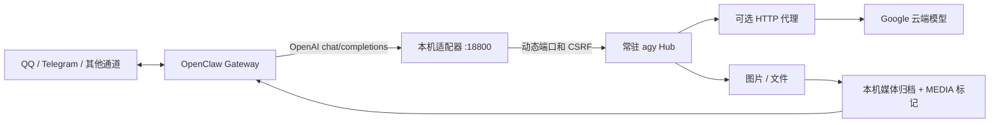

# Antigravity Hub → OpenClaw

将本机常驻的 Antigravity Hub 接入 OpenClaw，支持 QQ、Telegram 等通道发送模型输出的图片和附件。支持 macOS（复用已运行的 Hub）、Linux ARM64／x86_64，以及旧款 x86 CPU 的 QEMU 用户态兼容运行。

这是独立的社区实验项目，与 Google、Antigravity、OpenClaw 没有官方隶属关系。不附带任何账号、订阅、OAuth 凭据或官方二进制。请使用自己的账号和有权使用的服务。Google 官方不支持消费者登录的第三方封装，接口和可用性可能变化，详见 [FAQ](https://antigravity.google/docs/faq)。



使用 Hub 原生 RPC：`StartCascade`、`SendUserCascadeMessage`、`GetCascadeTrajectorySteps`。不逐轮调用 `agy -p`，不模拟 VS Code 客户端身份。模型在云端推理，Hub 和适配器在本机运行。

## 功能与边界

- `/v1/models`：实时读取当前账号启用的模型。
- `/v1/usage`：凭适配器密钥读取 Hub 当前模型配额百分比与重置时间。
- `/v1/quota`：凭适配器密钥读取 Hub 明确提供的 5 小时／周额度；不返回账号邮箱。
- `/v1/chat/completions`：文本对话、JSON 工具请求转换、会话复用、OpenAI SSE 封装。
- 原生终端／网页／MCP 等操作由 Hub 项目权限控制；实际能力还取决于本机工具和 MCP 服务是否已安装。
- 生成图片、附件及引用的本地文件会归档到 OpenClaw 媒体目录，作为 `MEDIA:` 输出交给聊天通道发送。
- 本机回环地址监听、随机适配器密钥、动态发现 Hub 端口和 CSRF、Linux systemd／macOS launchd 用户服务自恢复。

SSE 会立即建立连接并定期发送保活帧，最终答复仍在生成结束后整体发送，**不是实时逐字流**。只接受文本输入。工具转换基于提示中的 JSON 约定，并非完整的原生 OpenAI 工具协议。usage 返回零值，不代表没有使用云端额度。适配器串行处理生成；同时使用多个聊天端时可能返回 busy。尚未支持所有多模态和图像 blob 引用格式。

工具回复会严格检查 JSON、`tool_choice` 和参数 schema；当前支持的 JSON Schema 子集与 HTTP 错误码见[架构与接口](docs/ARCHITECTURE.md)。Hub 中途重启或生成超时不会自动重放请求；取消后未确认旧任务 idle 时，新请求返回 `hub_task_pending`，应检查 Hub 日志。

## 环境要求

- Linux + systemd 或 macOS + launchd，Python **3.8+**；运行时仅使用标准库。
- 已安装并可运行的官方 `agy` CLI；已安装且可正常运行的 OpenClaw。
- 自己的 Antigravity Google 账号及网络连接。
- QQ／Telegram 凭据仍由 OpenClaw 自己管理，本项目不创建机器人。

本项目基于 agy **1.4.7 / Hub 2.26.0** 实测。OpenClaw 不同版本的会话和命令参数可能变化，参见 [验证记录](docs/VALIDATION.md)。

## 安装

### macOS

macOS 安装器复用**当前用户已经运行且已登录**的 Antigravity Hub，不复制 OAuth 文件，也不启动第二个 Hub。先确保 Antigravity IDE／CLI 已启动 Hub，并从本项目目录运行：

```bash
python3 scripts/manage_macos.py install --workspace "$HOME/clawd" --timeout 3600 --port 18800
python3 scripts/manage_macos.py setup-project --allow-all-tools
python3 scripts/manage_macos.py smoke-test --model gemini-3.8-flash-high
python3 scripts/manage_macos.py configure-openclaw --model gemini-3.8-flash-high
openclaw gateway restart
python3 scripts/manage_macos.py doctor
```

如果 18800 已被占用，安装时改用空闲的回环端口（例如 `--port 18801`）；配置命令会读取安装时记录的端口。安装器只创建用户级 launchd 适配器服务，不修改系统网络或代理设置。`--allow-all-tools` 添加项目级 `command(*)`、`read_url(*)`、`execute_url(*)`、`mcp(*)`；这会扩大此项目内代理可执行的操作，**并不是操作系统隔离**。省略参数则不添加这些规则。旧模型名 `antigravity-pro` 保留为本地兼容别名，映射到安装时选择的模型，避免已有会话因模型 ID 失效。

如 Hub 返回额度耗尽，先不要将默认模型切到该 Hub：适配器会返回 429，待账号额度重置后再运行 `smoke-test`。macOS 的适配器可随 launchd 重启，但依赖的 Hub 仍需保持运行。详见[维护与排障](docs/OPERATIONS.md)。

### Linux

先从 [Antigravity 官方文档](https://antigravity.google/docs/getting-started) 安装 CLI。不要从本项目寻找或下载 OAuth 凭据。

```bash
git clone https://github.com/wuhui39852/antigravity-hub-openclaw.git
cd antigravity-hub-openclaw

# 安装到当前用户，不需要 sudo；代理地址按自己的环境调整。
python3 scripts/manage.py install \
  --workspace "$HOME/.openclaw/workspace" \
  --proxy http://127.0.0.1:7890
```

默认使用 OpenClaw 工作区作为项目范围。要采用整个人员主目录的配置，将 `--workspace` 改为 `"$HOME"`。这会扩大自动读取和附件归档的范围，应只处理自己信任的任务。

在**这台机器上**完成自己的 Google 登录。SSH 环境下打开 CLI 给出的登录链接，完成授权后将本次授权码输入 CLI：

```bash
HTTP_PROXY=http://127.0.0.1:7890 \
HTTPS_PROXY=http://127.0.0.1:7890 \
NO_PROXY=localhost,127.0.0.1,::1 \
~/.local/bin/agy
```

退出登录向导后，初始化本机 Hub 的授权文件：

```bash
python3 scripts/manage.py init-auth
# 等待 Hub 启动；首次启动可能需要几十秒。
python3 scripts/manage.py setup-project --allow-all-tools
python3 scripts/manage.py smoke-test
```

`init-auth` 仅把**当前机器当前用户自己的** CLI 授权初始化到当前 Hub 版本读取的位置，已有 Hub 授权默认拒绝覆盖。不会输出 token。后续刷新由 Hub 管理。请勿拷贝其他人的授权。

`--allow-all-tools` 为此项目允许 `command(*)`、`read_url(*)`、`execute_url(*)`、`mcp(*)`，文件规则限配置的工作目录。这些是 Hub 的审批规则，**不是操作系统的安全隔离边界**，尤其终端命令可以访问用户有权限访问的目录。省略该参数不会加入这些全部允许的规则。此操作不修改全局权限。

模型测试通过后接入现有 OpenClaw：

```bash
python3 scripts/manage.py configure-openclaw --model gemini-3.8-flash-high
# 确认当前没有正在执行的重要任务，再重启。
systemctl --user restart openclaw-gateway.service
python3 scripts/manage.py doctor
```

配置命令会备份正式配置，合并 HTTP provider、默认模型和依赖服务，保留已有聊天通道。模型必须在当前账号的可用列表中。上下文 131072／输出 8192 是本地配置值，并非云端官方额度声明。已有会话的模型或运行时覆盖需要另外检查，见 [维护指南](docs/OPERATIONS.md)。

让用户服务在无人登录时随开机运行：

```bash
sudo loginctl enable-linger "$USER"
loginctl show-user "$USER" -p Linger
```

### 老款 x86 CPU / E50

如果官方 agy 启动出现 `compiled with pclmul enabled`，可在该类旧设备上尝试 QEMU 用户态模拟，**不修改官方二进制**：

```bash
sudo apt-get install --no-install-recommends qemu-user
GODEBUG=asyncpreemptoff=1 qemu-x86_64 -cpu max ~/.local/bin/agy --version

python3 scripts/manage.py install \
  --workspace "$HOME" \
  --proxy http://127.0.0.1:7890 \
  --qemu /usr/bin/qemu-x86_64

# 登录也需使用兼容启动；按提示完成自己的授权。
HTTP_PROXY=http://127.0.0.1:7890 HTTPS_PROXY=http://127.0.0.1:7890 \
NO_PROXY=localhost,127.0.0.1,::1 GODEBUG=asyncpreemptoff=1 \
qemu-x86_64 -cpu max ~/.local/bin/agy
```

再执行上面的 `init-auth`、`setup-project`、`smoke-test`。模拟运行有性能和稳定性成本，不保证适用于所有老 CPU。不要在支持原生运行的 ARM64 设备上使用 x86 QEMU 参数。

## Telegram `/status` 显示 Antigravity 配额

`openclaw-status-plugin/` 是本项目附带的 OpenClaw 插件。它只在配置的 Telegram 私聊会话中，为原生 `/status` 回复追加指定模型的 Hub 配额；当前会话使用 GPT‑6.1 Sol 时也能查看。配额在 `/status` 请求时读取，adapter 另每 30 秒刷新本地快照，不会主动向聊天推送。查询失败会标注“暂不可用”，不影响原有状态内容。

Hub `RetrieveUserQuotaSummary` 可用时，插件显示 Hub 明确标注的 5 小时／周额度。若该查询不可用，回退到 `GetUserStatus` 的单个剩余比例与重置时间，并明确标注“独立周额度：Hub 未提供”；不会推测额度窗口或混用 OpenAI 额度。

插件安装后在 `plugins.entries.antigravity-hub-status.config` 设置：

```json
{
  "sessionKeys": ["agent:main:telegram:<account>:direct:<chat-id>"],
  "adapterUrl": "http://127.0.0.1:18801",
  "keyFile": "/absolute/path/to/antigravity-hub-adapter/adapter.key",
  "model": "gemini-3.8-flash-low",
  "timeZone": "Asia/Shanghai"
}
```

`sessionKeys` 必须明确指定，避免将账号配额发到其他聊天。插件入口见 [openclaw-status-plugin](openclaw-status-plugin/)；安装／启用和重启 Gateway 应按当前 OpenClaw 版本的插件命令执行。

## 输出图片和附件

例如在聊天端要求：“生成结果文件，并在最终回复附上文件。”适配器会从 Hub 输出和最终答复中收集本地文件，归档后输出：

```text
MEDIA:/absolute/path/to/.openclaw/media/antigravity/<hash>-result.png
MEDIA:/absolute/path/to/.openclaw/media/antigravity/<hash>-result.txt
```

聊天通道是否支持、文件大小和类型限制由 OpenClaw 通道决定。适配器每个文件上限 20 MiB，仅接收项目目录或预设 Hub 产物目录内的允许类型，解析符号链接后检查范围；不会下载远程图片。图片生成能力取决于账号和模型；验证中的红色 PNG 是终端生成的测试文件，不代表已经验证云端文生图。

## 文档与测试

- [架构与接口](docs/ARCHITECTURE.md)
- [维护、排障与回滚](docs/OPERATIONS.md)
- [真实设备验证记录](docs/VALIDATION.md)
- [安全说明](SECURITY.md)
- [类似项目对照](docs/RELATED_PROJECTS.md)

```bash
python3 -m unittest discover -s tests -v
python3 -m compileall -q src scripts tests
```

单元测试不需要账号，不调用 Google，不发送聊天消息。真实模型测试 `smoke-test` 会使用自己的账号额度。

## 参考与许可

- [官方 CLI 文档](https://antigravity.google/docs/getting-started)
- [项目权限](https://antigravity.google/docs/permissions)
- [官方 FAQ](https://antigravity.google/docs/faq)
- [旧 CPU 兼容问题](https://github.com/google-antigravity/antigravity-cli/issues/378)
- [QEMU 用户态模拟](https://www.qemu.org/docs/master/user/main.html)
- [OpenClaw 模型配置](https://docs.openclaw.ai/cli/models)

本仓库原创适配器与脚本使用 [MIT](LICENSE) 许可；Antigravity、OpenClaw、QEMU 各自遵循其自身许可和服务条款。本项目不分发上述软件的二进制。
